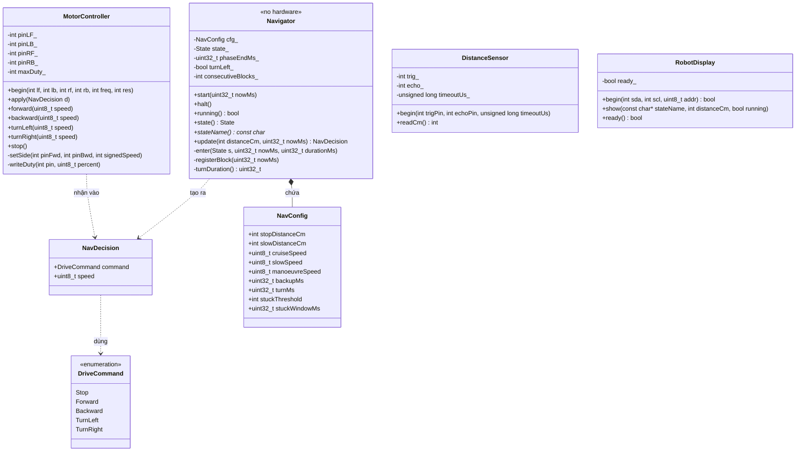
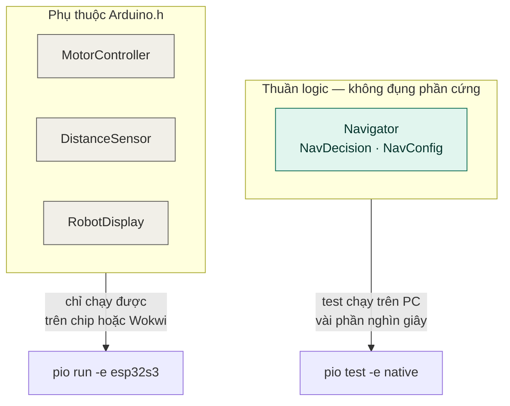

# Class diagram

Cấu trúc lớp hiện tại của repo. Tên lớp và tên hàm khớp đúng với code, nên dùng sơ đồ này để tra cứu khi làm bài tập.

## Hai nhóm lớp, khác nhau ở một điểm duy nhất

Ranh giới này là quyết định kiến trúc quan trọng nhất của dự án, ghi ở `docs/quyet-dinh.md` mục QĐ-03.

`Navigator` không biết động cơ tồn tại. Nó nhận một con số và một mốc thời gian, trả về một quyết định. Nhờ vậy test chạy được trên máy tính, và sang giai đoạn 3 hai file này chép thẳng sang firmware ESP-IDF mà không sửa một ký tự.

## Quan hệ giữa các lớp

`Navigator` và `MotorController` không biết nhau. Chúng chỉ cùng biết kiểu `NavDecision`.

Đó là lý do hai người làm hai mảng này song song được: hợp đồng giữa họ là một struct nhỏ, đã khai báo sẵn trong header và không ai được tự ý đổi. Muốn đổi thì phải bàn với cả nhóm — xem `docs/phan-cong.md`.

`main.cpp` là nơi duy nhất biết cả bốn lớp. Nó giữ các đối tượng và nối chúng lại với nhau. Không lớp nào trong `lib/` được phép gọi sang lớp khác trong `lib/`.
