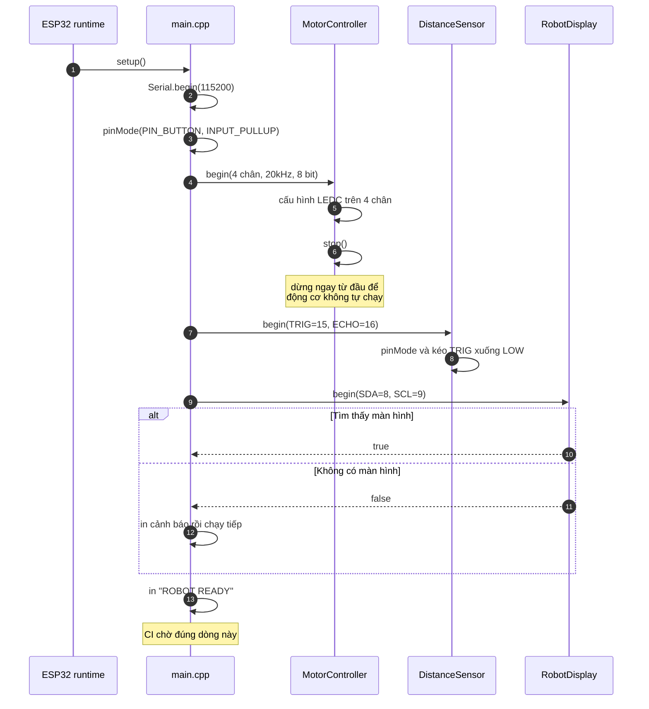
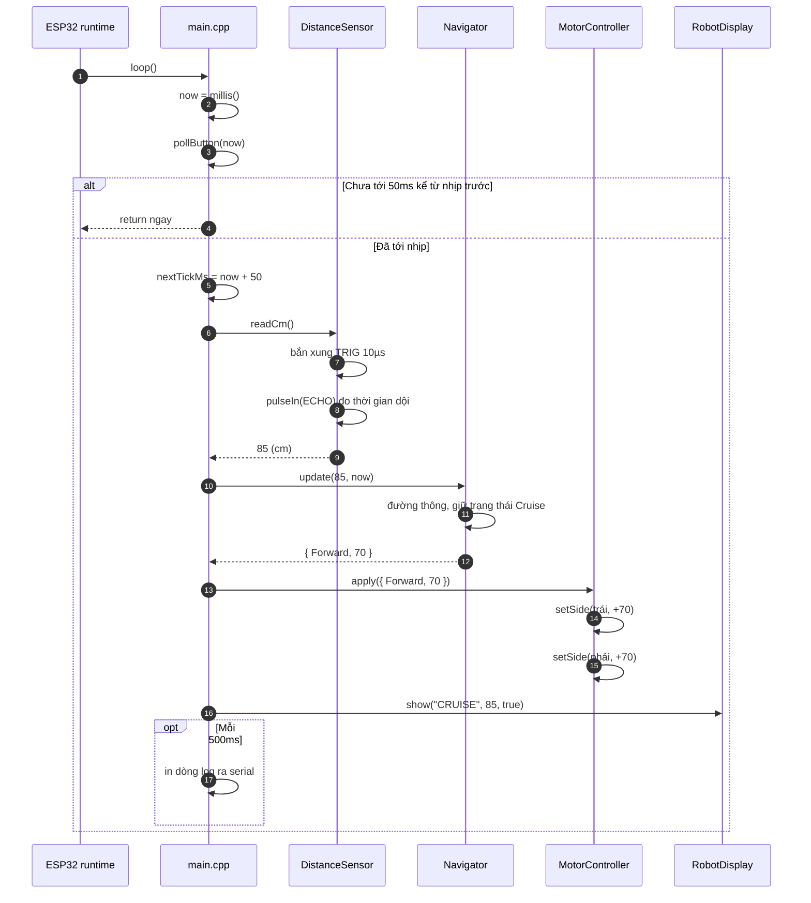
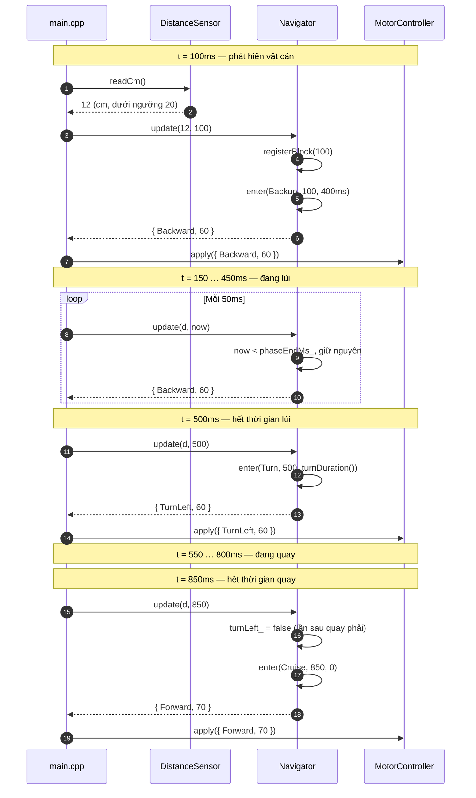
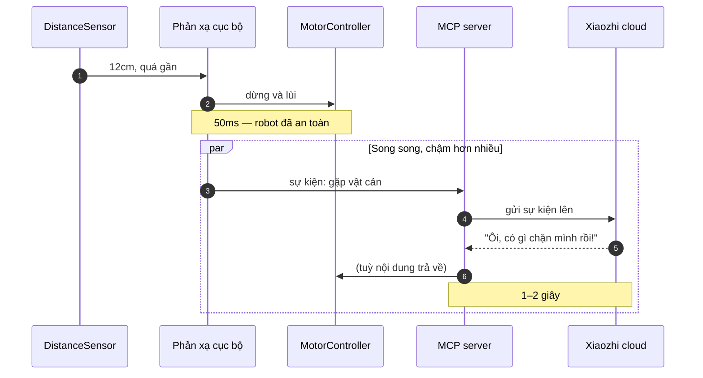

# Sequence diagram

Ba kịch bản quan trọng nhất, vẽ theo trình tự thời gian.

## 1. Khởi động

Điểm đáng chú ý: thiếu màn hình thì chương trình vẫn chạy tiếp, chỉ in một dòng cảnh báo. Thiết bị phụ không được phép làm chết cả hệ thống.

## 2. Một nhịp chạy bình thường

Nhịp 50ms không phải con số tuỳ tiện. Nhanh hơn thì cảm biến siêu âm chưa kịp nghe tiếng dội của lần đo trước, số đo sẽ loạn. Chậm hơn thì robot phản ứng không kịp ở tốc độ di chuyển thường gặp.

## 3. Gặp vật cản — chuỗi lùi và quay

Hai chi tiết quyết định chất lượng thuật toán nằm ở sơ đồ này.

Thứ nhất, `turnLeft_` đảo chiều sau mỗi lần quay. Không đảo thì robot gặp góc tường sẽ quay trái mãi và xoay vòng tròn không thoát ra được.

Thứ hai, `registerBlock` đếm số lần vướng liên tiếp. Nếu vướng ba lần trong vòng ba giây thì `turnDuration()` trả về thời gian dài gấp ba, để robot quay hẳn ra thay vì loay hoay tại chỗ.

## 4. Giai đoạn 3 — hai đường xử lý song song

Sơ đồ này mô tả kiến trúc sẽ có sau khi ghép AI, chưa áp dụng cho repo hiện tại.

Đây là lý do tránh vật cản không được đi qua AI. Vòng AI mất một đến hai giây; robot chạy 20cm mỗi giây thì trong hai giây đã đâm vào tường và đẩy thêm 20cm nữa.

Phản xạ giữ cho robot không va chạm. AI làm cho nó dễ thương. Hai việc khác nhau, chạy ở hai tốc độ khác nhau, và không được trộn vào nhau.
