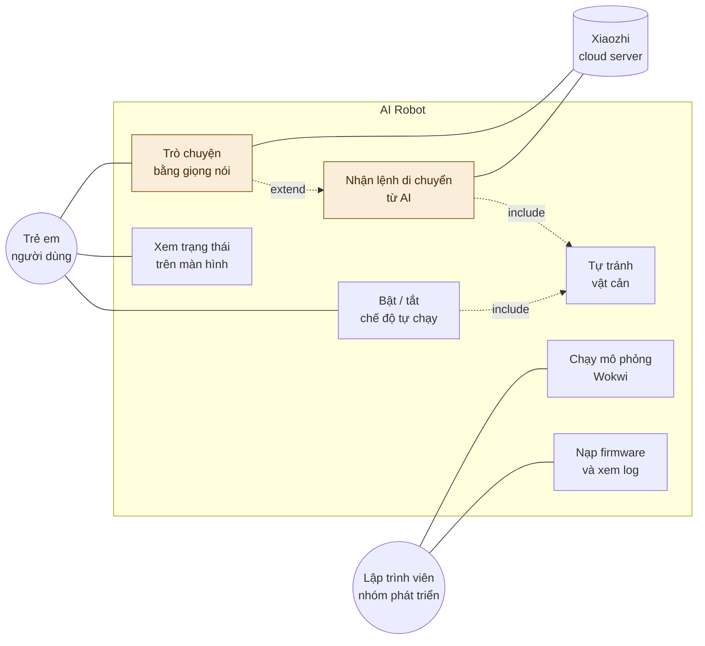

# Use case diagram

Sơ đồ ca sử dụng cho toàn hệ thống, gồm cả phần sẽ làm ở giai đoạn 3 để thấy bức tranh đầy đủ.

Hai ô nền vàng là phần của giai đoạn 3, chưa làm ở repo này.

## Giải thích từng ca

| Ca sử dụng | Tác nhân | Giai đoạn | Mô tả |
|---|---|---|---|
| Bật / tắt tự chạy | Trẻ em | 0–1 | Bấm nút để robot bắt đầu hoặc dừng di chuyển |
| Tự tránh vật cản | — | 0–1 | Phản xạ cục bộ, chạy liên tục khi đang ở chế độ tự chạy |
| Xem trạng thái | Trẻ em | 0–1 | Màn hình OLED hiện trạng thái và khoảng cách |
| Nạp firmware, xem log | Lập trình viên | 0–2 | Build, nạp, đọc serial để gỡ lỗi |
| Chạy mô phỏng | Lập trình viên | 0–1 | Kiểm thử trong Wokwi, không cần phần cứng |
| Trò chuyện giọng nói | Trẻ em | 3 | Bấm giữ nút để nói, robot trả lời |
| Nhận lệnh từ AI | — | 3 | Mô hình gọi MCP tool để điều khiển robot |

## Điểm đáng chú ý

Quan hệ `include` từ "Nhận lệnh từ AI" tới "Tự tránh vật cản" là chỗ dễ hiểu nhầm. Nó không có nghĩa AI quyết định việc tránh vật cản.

Nó có nghĩa: ngay cả khi AI đang ra lệnh đi tới, lớp tránh vật cản vẫn chạy song song và có quyền ghi đè. AI bảo đi, nhưng nếu phía trước có tường thì robot vẫn dừng. Lý do nằm ở `docs/kien-truc.md` — vòng AI mất một đến hai giây, quá chậm để phản ứng kịp.
